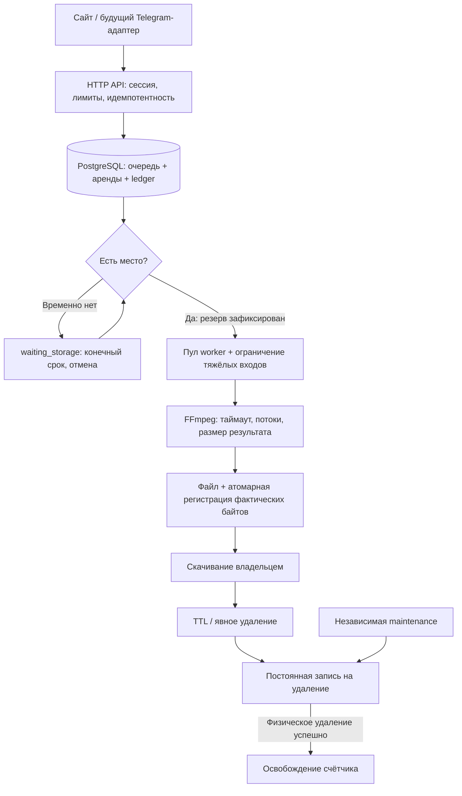
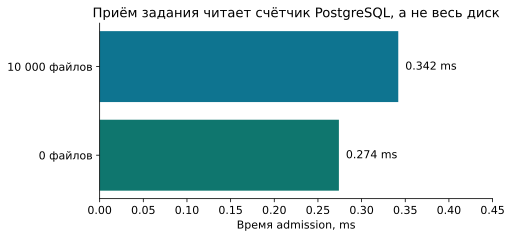
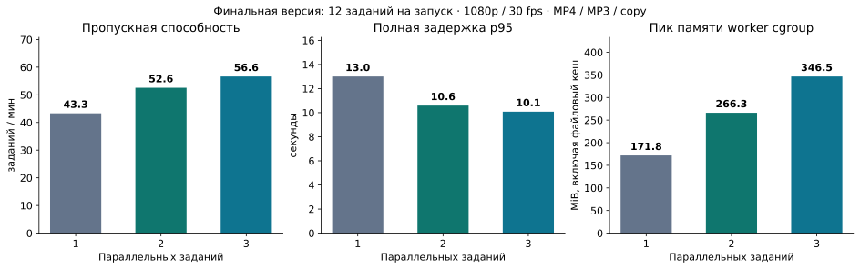

# Повторный аудит и исправления — 5 октября 2026

Исходный системный отчёт повторно сопоставлен с кодом ядра, интерфейса и эксплуатации. Исправления покрывают хранение, очередь, ограничение ресурсов, восстановление, сетевую изоляцию, права БД и пользовательские сценарии. Ниже отделены реализованное поведение, результаты измерений и внешние условия, которые ещё требуют настройки.

Ядро: `0461f4511a0a5d74f1408a9c3921f1383ef3f965`. Сайт закрепляет эту ревизию в `core.version`; версии развёртывания записываются в `/opt/cutmy/current/release.env`. Рабочий сервер — `2.26.124.119`, 6 vCPU / 12 GB RAM / 150 GB диска. Предыдущий сервер остаётся резервом миграции.

## Что исправлено

| Пробел или найденный пограничный случай | Теперь |
| --- | --- |
| Переполнение диска между проверкой и записью; параллельные загрузки | Общие PostgreSQL-резервы, транзакционные счётчики фактических/зарезервированных байтов, проверка свободного места и запас 512 MiB |
| Обход всего хранилища при каждом admission | Чтение одной строки счётчика; индексы и агрегирование триггеров на SQL-операцию |
| Задание не помещается сейчас или получает ENOSPC при обработке | `waiting_storage` с постоянным сроком 30 минут; не расходует попытку обработки; отмена работает сразу |
| Заведомо невозможное задание | Отказ до постановки в очередь; UI предлагает уменьшить число фрагментов |
| Один пользователь занимает начало очереди | Ротация владельцев, FIFO внутри владельца, ограниченная выборка 128 кандидатов; заблокированные по диску владельцы тоже ротируются |
| Очистка зависит от живого worker | Отдельная `cutmy maintenance`, запускаемая cron; ограниченные партии и таймауты |
| Файл не удалился, но квота уже освободилась | Постоянная запись на удаление; байты остаются занятыми до успешного unlink |
| Новый worker снял резерв старого процесса | Отдельный резерв на каждую аренду, fencing и защитный интервал перед удалением старого workspace |
| Сбой между публикацией файла и записью в БД | Регистрация результата и состояния атомарна; неопределённый COMMIT не удаляет потенциально зарегистрированный файл |
| Большой список файлов/осиротевших путей потребляет RAM | Сканирование по 128 записей, пакетный запрос известных путей; без набора всех путей в памяти |
| 8 MiB stdout / 16 KiB stderr можно обойти через `io.Copy` | Убрано встраивание `bytes.Buffer`, которое предоставляло обходной `ReadFrom`; переполнение stdout завершает группу процессов |
| Несколько тяжёлых декодеров одновременно | Пул 1–8 заданий; неизвестное видео или вход свыше 8 388 608 пикселей занимает весь локальный пул |
| Злоупотребление потоками, размерами кадра и временем | До 32 потоков, 33 554 432 пикселей, 256 MiB на отдельное выделение FFmpeg; ограниченные потоки декодирования, таймауты и cgroup |
| Библиотека вызывается из бота с `context.Background()` | Inspection по умолчанию 2 минуты, export 30 минут; отмена убивает дочернюю группу, существующий результат не перезаписывается |
| SSRF при ошибке/обходе настроек extractor | Проверка и закрепление публичных адресов плюс отдельный Docker egress: PostgreSQL, публичные DNS/HTTPS; блок внутренних/metadata адресов и отдельный запрет новых соединений к хосту |
| Контейнеры стартуют после reboot раньше firewall | API/worker управляются systemd после установки egress; автоматический старт Docker не обходит порядок |
| Root SSH принимает опубликованный пароль | Вход по паролю/keyboard-interactive закрыт; новая независимая сессия по ключу проверена после reload |
| Приложение имеет PostgreSQL SUPERUSER | Отдельная административная роль; обычная роль приложения. Bootstrap-владелец системных каталогов сохраняется с NOLOGIN |
| Резервная копия повреждена или заполнит диск | Потоковый gzip, SHA-256, CRC и проверка окончания дампа, атомарная публикация, сроки/объём хранения, ограничение распаковки и времени |
| Есть дамп, но восстановление не проверялось | Восстановление в отдельный PostgreSQL и проверка принадлежности/ссылок; отдельный режим восстановления БД без отсутствующих медиа |
| Пользователь не понимает загрузку/удаление/TTL | Прогресс переданных байтов, сроки хранения, список своих источников, подтверждение удаления, защита активных заданий |
| Скрытая вкладка продолжает опрос и воспроизведение | Остановка опроса/плеера; немедленное обновление при возвращении; поздний ответ не отменяет актуальное состояние |
| Черновик повреждён, источник истёк или ответ на POST потерян | Ограниченные размеры localStorage, проверка чисел/идентификаторов, сохранение при временной ошибке, идемпотентный повтор без дубликата |
| Лимиты frontend и API расходятся | Публичные лимиты из `/session`, ранняя проверка файла/интервалов, синхронизация body cap на HTTPS edge |

## Путь задания и учёт места

Резерв рассчитывается по верхней границе каждого ещё не опубликованного результата; для platform/HLS добавляется ограниченный временный вход. Это консервативно: короткое видео может зарезервировать больше фактического размера. Зато пакет не зависает после создания первых результатов и не зависит от угадывания битрейта. Публикация каждого фрагмента заменяет его максимальный резерв фактическими байтами. Неопределённые операции и неудачное удаление сохраняют учёт до восстановления.

Это локальный микробенчмарк PostgreSQL на Ryzen 9 5950X / Go 1.27.1: 0,274 ms без файлов и 0,342 ms при 10 000 строках ledger, 586 B / 16 allocations на вызов. Он исключает загрузку и кодирование и не измеряет производительность рабочего сервера.

## Измерения на новом сервере

Изолированные контейнеры на том же сервере: PostgreSQL 17, производственный FFmpeg 5.1.9, API 1 CPU / 512 MiB, worker 3 CPU / 4 GiB. Четыре независимые сессии, по три задания: accurate MP4, MP3, копирование потоков. Источник — синтетический H.264/AAC 1920×1080, 30 fps, 30 секунд; каждый экспорт — 6 секунд. Во всех трёх запусках завершились 12 из 12 заданий.

| Параллельность | Заданий/мин | Ожидание p95 | Полная задержка p95 | Пик памяти worker cgroup |
| --- | ---: | ---: | ---: | ---: |
| 1 | 43,321 | 12,723 s | 13,005 s | 171.84 MiB |
| 2 | 52,551 | 10,279 s | 10,592 s | 266.28 MiB |
| 3 | 56,632 | 8,638 s | 10,083 s | 346.53 MiB |

От одного до трёх обработчиков пропускная способность выросла на 30,7%. Это результат конкретного короткого теста. Пик cgroup включает файловый кеш и не равен RSS FFmpeg. Измерена финальная ревизия ядра `0461f451`; в JSON сохранены полный commit, неизменяемый Docker image ID, SHA-256 бинарника и исходного файла. Скачанные результаты дополнительно проверены FFprobe после измеряемой фазы.

В отдельном всплеске 36 заданий при двух слотах сервер принял 32; четыре запроса получили HTTP 429 `job_limit`. Все 32 принятых задания завершились. Полная задержка p95 — 29,650 секунды, пик worker cgroup — 380,68 MiB. Проверки очереди отдельно покрывают временную нехватку диска, восстановление, справедливость владельцев и отмену.

Исходные данные и профили: `reports/audit-fixes-2026-10-05/operations/load/` в рабочем каталоге оператора. Повторяемый инструмент — [load-profile.py](../scripts/load-profile.py). Эти цифры не означают поддержку 1000 одновременных кодирований: для оценки нужны реальные длительности, кодеки, разрешения, доля активных пользователей и скорость внешних площадок.

## Проверка изменений

Go: `go vet`, сборка и полный `go test -race -count=1 ./...` с отдельной PostgreSQL-БД — **386 успешных тестов, без пропусков**. Проверены реальные MP4/MP3/copy, MPEG-TS/fMP4 HLS, первые кадры и задержка аудио, лимиты, конкурирующая публикация, отмена, потеря аренды, отказ записи/удаления и независимые экземпляры API. `govulncheck` не нашёл уязвимостей в используемом Go-коде.

Frontend: **88 unit-тестов**, production build, 65 различных успешных браузерных сценариев, 2 явных пропуска внешних provider-тестов и матрицы Chromium/Firefox/WebKit (840 записей измерений). Проверки включают загрузку/скачивание, уменьшенные лимиты, удаление, восстановление черновика, отсутствующий звук, доступность кнопок на небольшом экране и клавиатурную навигацию. Сетевые проверки отдельных внешних провайдеров требуют явного включения; они не подменяются фиктивным успехом. Полные сведения — [QA.md](QA.md). `npm audit`, включая dev-зависимости, не нашёл известных уязвимостей.

Эксплуатация: 48 успешных unit/fault-проверок; отдельная реальная PostgreSQL-regression покрывает штатно отключённый в обычном discover integration-тест и включена обязательным CI-заданием. Проверены прерывание backup, повреждения дампа, rollback окружения/cron/systemd, блокировок, восстановления прав БД и реальных правил iptables. Дамп прежнего состояния восстановлен в отдельном PostgreSQL за **4,748 s**: 16 источников, 15 заданий, 24 результата, нарушений принадлежности нет. Сценарий полной потери медиа проверен за **5,059 s**: сохранены доступные platform-источники, задания без входа завершены понятной ошибкой. Это время небольшого восстановления БД; полный RTO нового сервера и восстановление самих медиа этим не измерены.

## Эксплуатационные границы

Локальные копии БД создаются ежечасно и сохраняются до 7 дней, максимум 168 копий / 4 GiB. Они защищают от ошибки БД, но не от потери всего сервера. Подготовлены отправка копии на другой сервер через SSH/rsync и адаптер уведомлений о сбое/восстановлении. **Удалённое хранилище и внешний канал оповещений не включены: пользователь ещё не сообщил места назначения.** Секреты должны передаваться вне Git и отчёта; локальный монитор сохраняет события самостоятельно.

Медиа остаются временными файлами на локальном диске с TTL. Копия PostgreSQL не содержит видео. Режим восстановления только БД согласует записи с отсутствующим диском; он не обещает восстановить потерянные загрузки. Для долговременного хранения пользовательских видео понадобится отдельная политика и хранилище.

IP limiter пока локален одному API. Ledger и аренды поддерживают несколько процессов, но горизонтальное масштабирование API требует общего limiter; несколько серверов worker также требуют общей файловой системы либо нового storage adapter. Бот должен ставить задания в ту же очередь; прямой запуск библиотечных экспортов в отдельных goroutines обойдёт серверные квоты.

Проверки не доказывают отсутствие любых будущих ошибок или безопасность неизвестного медиакодека. Обновления, ограничения контейнеров и наблюдение за настоящей нагрузкой остаются частью эксплуатации. Существенные конфигурации, процедура восстановления и проверка запуска описаны в [DEPLOYMENT.md](DEPLOYMENT.md).
